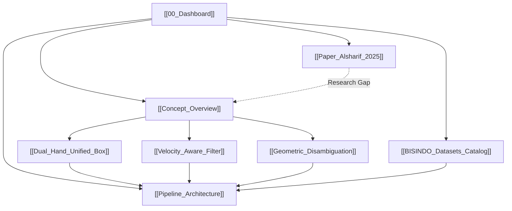

# 🚀 Dashboard Utama: Sistem Penerjemah BISINDO Real-Time

Selamat datang di knowledge base proyek mata kuliah **Computer Vision (C&V) — Semester 5**. Vault ini disusun dengan arsitektur modular yang saling terhubung menggunakan bidirectional wikilinks `[[...]]` untuk navigasi interaktif dan visualisasi graf melalui **Obsidian Graph View** dan **Graphify**.

---

## 🗺️ Map of Content (MOC)

---

## 📂 Struktur Modul Knowledge Base

### 1. Kajian Literatur & Baseline
* [[Paper_Alsharif_2025]] — Kajian mendalam paper acuan *Sensors MDPI 2025* (MediaPipe + YOLOv11).
* [[PLANNING_MODIFIKASI_PENELITIAN]] — Dokumen perencanaan lengkap komparasi 12 jurnal dan justifikasi novelty.

### 2. Konsep Sistem & Modifikasi yang Diusulkan
* [[Concept_Overview]] — Arsitektur besar sistem penerjemah BISINDO real-time.
* [[Dual_Hand_Unified_Box]] — Penanganan gestur dua tangan via penggabungan bounding box dinamis.
* [[Velocity_Aware_Filter]] — Fitur tambahan 1: Filter kecepatan temporal untuk membuang huruf hantu (*ghost detection*).
* [[Geometric_Disambiguation]] — Fitur tambahan 2: Modul pembeda huruf mirip (M vs N) berbasis sudut sendi 3D.

### 3. Data & Implementasi Teknis
* [[BISINDO_Datasets_Catalog]] — Sumber dataset publik terverifikasi (Roboflow Universe, Mendeley Data, Kaggle).
* [[Pipeline_Architecture]] — Alur kerja pemrosesan citra dari webcam hingga teks akhir.
* [[Training_Report_YOLOv11n]] — Laporan eksperimen dan metrik pelatihan model YOLOv11n BISINDO.
* [[Realtime_Testing_Report]] — Laporan pengujian webcam real-time (validasi single-hand dan dual-hand 42 keypoints).

---

## ⚡ Quick Links & Deliverables
* Dokumen Memory & State Sesi: [[PROJECT_MEMORY]]
* Dokumen Usulan Resmi: [USULAN_MODIFIKASI_PENELITIAN_BISINDO.docx](file:///e:/Semester%205/C&V/Project%20Citra/brain/USULAN_MODIFIKASI_PENELITIAN_BISINDO.docx)
* Panduan Saran Fitur: [[SARAN_MODIFIKASI_FITUR_BISINDO]]
