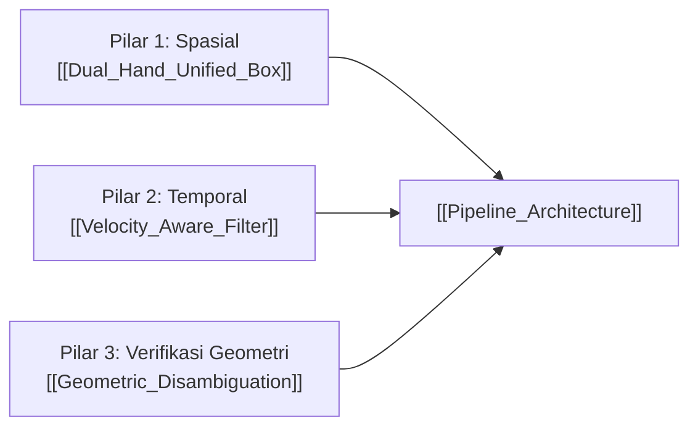

# 💡 Ikhtisar Konsep Modifikasi Sistem BISINDO

*Navigasi:* [[00_Dashboard]] | Baseline: [[Paper_Alsharif_2025]] | Pipeline: [[Pipeline_Architecture]]

---

## 🎯 Tujuan Penelitian Usulan
Mengembangkan sistem penerjemah alfabet **Bahasa Isyarat Indonesia (BISINDO)** secara *real-time* berbasis kamera webcam standar dengan mengatasi 3 kelemahan mendasar dari model baseline [[Paper_Alsharif_2025]].

---

## 🧩 Tiga Pilar Modifikasi Kunci

### 1. [[Dual_Hand_Unified_Box|Pilar Spasial: Penanganan Gestur Dua Tangan]]
* Mengalihkan objek dari ASL ke **BISINDO**.
* Mengonfigurasi MediaPipe untuk mendeteksi dua tangan (42 keypoints) dan menerapkan kalkulasi kotak terpadu (*Unified Bounding Box*) saat kedua tangan berinteraksi pada huruf B, D, M, N, P, dan Q.

### 2. [[Velocity_Aware_Filter|Pilar Temporal: Filter Kecepatan Gerak]]
* Menghitung vektor kecepatan gerak pergelangan tangan antar-frame.
* Menghentikan inferensi YOLO saat tangan bergerak aktif berpindah pose untuk mengeliminasi huruf hantu (*ghost detection*).

### 3. [[Geometric_Disambiguation|Pilar Geometri: Pembeda Huruf Mirip]]
* Menggabungkan *Deep Learning* (YOLOv11) dengan *Classical Geometric Vision* (perhitungan sudut sendi MediaPipe) untuk memastikan kebenaran huruf-huruf dengan bentuk fisik yang hampir identik.

---

## 📚 Sumber Data Terkait
Untuk data latih dan uji, sistem merujuk pada katalog dataset di [[BISINDO_Datasets_Catalog]].
