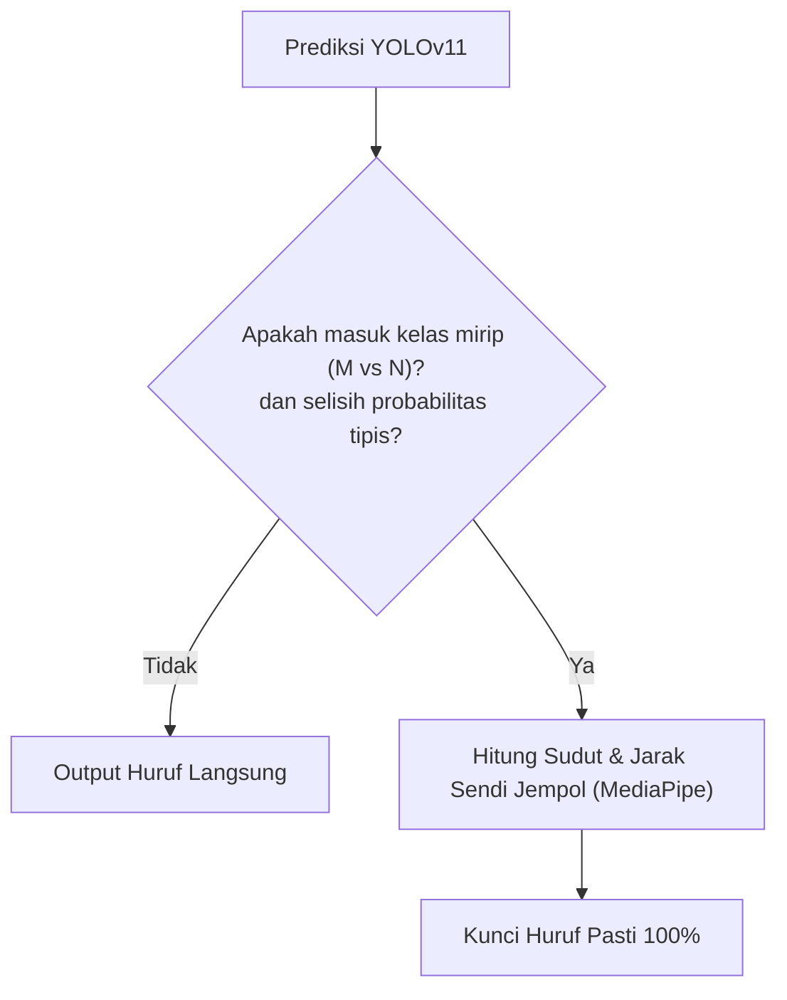

# 📐 Modul Geometric Disambiguation

*Navigasi:* [[00_Dashboard]] | Induk: [[Concept_Overview]] | Pipeline: [[Pipeline_Architecture]]

---

## 📌 Masalah yang Diselesaikan (*Visual Ambiguity*)
Model deteksi objek visual berbasis CNN/YOLO sering kali bingung (fluktuasi *confidence*) pada pasangan huruf BISINDO yang bentuk kepalannya hampir identik, seperti:
* **Huruf M vs N:** Perbedaannya hanya pada apakah ibu jari terselip di bawah 3 jari (M) atau 2 jari (N).
* **Huruf A vs E:** Posisi kepalan mirip, berbeda pada tekukan ujung jempol.

---

## ⚙️ Mekanisme Kerja Hibrida (Deep Learning + Geometri)

1. **Pemicu Ambigu:** Jika YOLOv11 memprediksi kelas dalam kelompok huruf ambigu dan selisih probabilitasnya tipis:
   $$|P_{\text{class1}} - P_{\text{class2}}| < 0.20$$
2. **Kalkulasi Geometri MediaPipe:** Sistem memeriksa sudut tekukan ruas sendi ibu jari (landmark 4) terhadap pangkal jari manis (landmark 13) dan jari tengah (landmark 9):
   $$\theta_{\text{thumb}} = \arctan2(y_4 - y_0, x_4 - x_0)$$
3. **Keputusan Pasti:** Huruf ditentukan secara deterministik matematis, menghilangkan keraguan pada klasifikasi visual murni.
