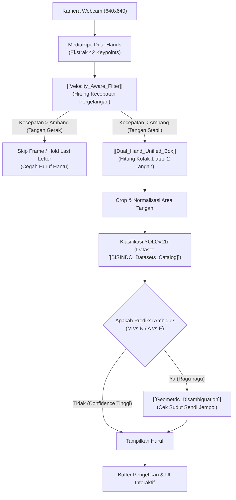

# 🏗️ Arsitektur Pipeline Sistem Keseluruhan

*Navigasi:* [[00_Dashboard]] | Konsep: [[Concept_Overview]] | Baseline: [[Paper_Alsharif_2025]]

---

## 🔄 Alur Pemrosesan Frame Real-Time

---

## ⚡ Estimasi Latensi Komputasi per Frame (CPU Laptop i7)
1. **Preprocessing:** ~1,1 ms
2. **MediaPipe Tracking (42 Titik):** ~12,0 ms
3. **Velocity Filter Calculation:** ~0,1 ms
4. **Bounding Box Calculation:** ~0,1 ms
5. **YOLOv11n Inference (jika fase stabil):** ~55,0 ms *(Jika fase gerak, YOLO di-skip $\rightarrow$ latensi 0 ms!)*
6. **Geometric Disambiguation (opsional):** ~0,2 ms
7. **Total Latensi Rata-rata:** ~68,5 ms (**~15 FPS pada CPU murni laptop standar**)
